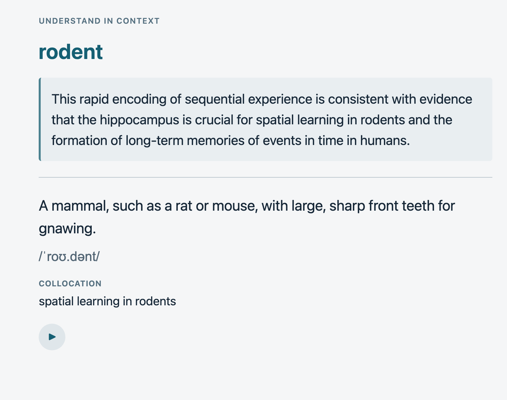
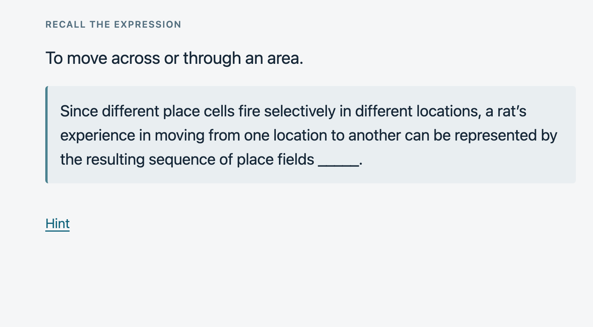
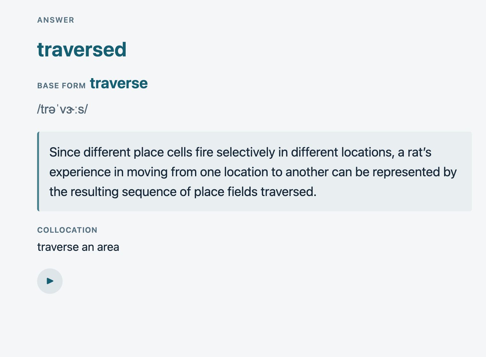

# Academic Vocabulary

A local Agent Skill plus Python standard-library scripts. It works in local runtimes that support skills, such as Codex and Claude Code. The main entry point is `SKILL.md`.

## Cards

Each sense becomes one note with a Receptive card, a Productive card, or both. The examples below are real cards collected with this skill; ▶ marks the read-aloud button.

Receptive card: the front shows the term in its original sentence; the back adds a brief English definition, American IPA and a collocation.



Productive card: the front shows the definition and the sentence with a blank, plus an optional hint.



The back shows the form used in the sentence, the base form, IPA, the full sentence and a collocation.



## Install

Ask a local agent that can run shell commands, such as Claude Code or Codex:

```text
Install the agent skill from https://github.com/RowanXB/academic-vocabulary-anki on this computer.
```

Agents and manual installers follow the same steps in [references/setup.md](references/setup.md#installation).

## Documentation

- [references/setup.md](references/setup.md): requirements, installation and initialization.
- [references/operations.md](references/operations.md): daily use, maintenance and troubleshooting.
- [references/development.md](references/development.md): how data is stored and how to test.

## Files

- `scripts/intake.py`: validates, persists and automatically attempts a sync.
- `scripts/sync.py`: initializes, checks status and retries pending syncs.
- `scripts/lookup.py`: looks up known senses.
- `scripts/common.py`: fixed data structures, persistence and API communication.
- `assets/`: two Front/Back card templates and CSS.
- `tests/`: non-destructive automated tests.
- `evals/`: language-generation examples and evaluation cases.
- `config.json`: local endpoint and Anki profile binding; contains no secrets.
- `data/pending.jsonl`: records awaiting sync; created on the first collected word.
- `data/history.jsonl`: confirmed import receipts and context history.

There is no background agent and no long-running service. Pending records are retried the next time a word is collected; opening Anki alone does not process the queue.

License: [MIT](LICENSE).
